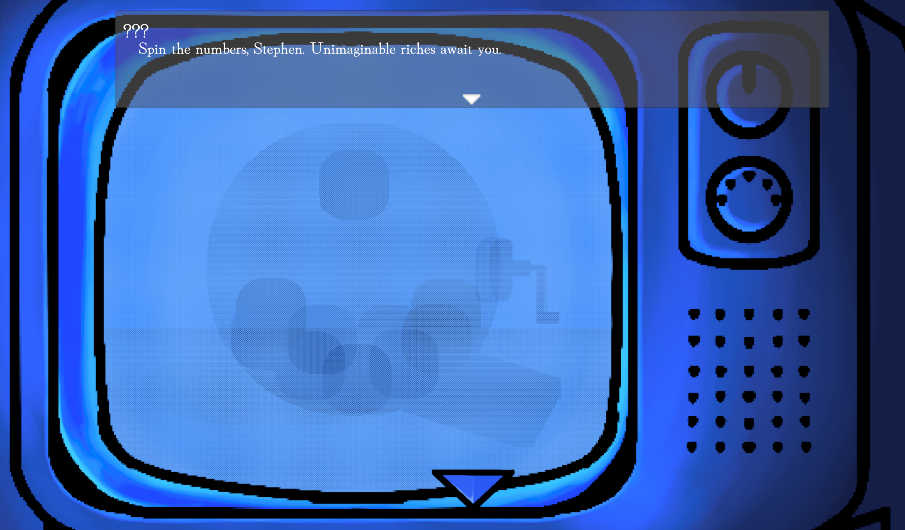
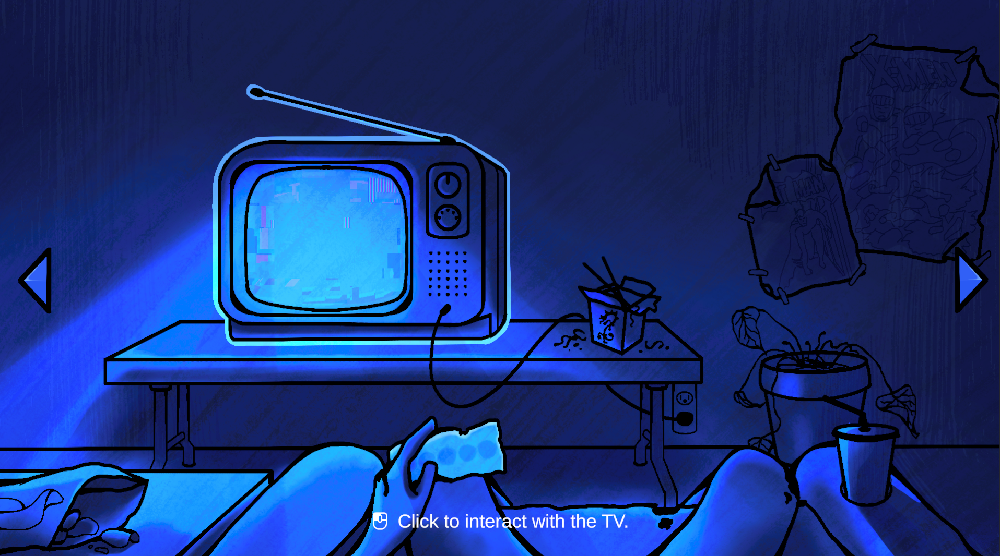

Lucky Bingo is a short psychological-horror point-and-click game made for the 2026 Unity Game Jam, with the theme "Lucky Number".

Spin the numbers Stephen. Unimaginable riches await you.

Steve is down on his luck. His rent is due the next day, and he doesn't have 2 cents to rub together. But as he's walking home, he finds a lottery ticket sticking out of a gutter. He thinks nothing of it until the first number drawn on the lotto that night matches the one on his ticket.

But luck has a price. Will Steve keep playing?

  <a class="project-link-button itch" href="https://sebastiansalas94.itch.io/lucky-bingo" target="_blank" rel="noopener noreferrer">Itch.io</a>
  <a class="project-link-button github" href="https://github.com/sebastiansalas94/LuckyBingo" target="_blank" rel="noopener noreferrer">GitHub Repo</a>

**Gameplay:**

Guide Steve's decisions through this short and fun psychological-horror game and explore its multiple endings. 

<video autoplay loop muted playsinline style="width: 800px;">
  <source src="/assets/video/LuckyBingo/LuckyBingo_Gameplay.mp4">
</video>

**Collaborative Team:**

The music and ambience were made by @JaniNdl in FMOD, and the art by @ElysiaLi. In 7 days, we designed, developed, and finished the game we had in mind.

  

  

**Process:**

The Game Jam was in seven days + a buffer of 2 days. We first started doing the brainstorming of the game with the theme. Then we begin prototyping while using MDA and a shared Design Document. We begin prototyping with the initial idea of a short horror story relating to luck and it trap us.

08/11/2026
This is the prototype with the first sequence with the roll animation. 
<video autoplay loop muted playsinline style="width: 800px;">
  <source src="/assets/video/LuckyBingo/LuckyBingo_Sequence.mp4">
</video>

09/11/2026
This is the prototype with the whole sequence. 
<video autoplay loop muted playsinline style="width: 800px;">
  <source src="/assets/video/LuckyBingo/LuckyBingo_v0.2.mp4">
</video>

10/11/2026
Initially we had this idea to mingle the results with a minigame but due to running out of time we decided to not use it. This is the prototype of the idea.
<video autoplay loop muted playsinline style="width: 800px;">
  <source src="/assets/video/LuckyBingo/LuckyBingo_Minigame.mp4">
</video>

13/11/2026
Initially we had this idea to mingle the results with a minigame but due to running out of time we decided to not use it. This is the prototype of the idea.

<video autoplay loop muted playsinline style="width: 800px;">
  <source src="/assets/video/LuckyBingo/LuckyBingo_WinBingoEnding.mp4">
</video>

**Genre:** Psychological-Horror Point-and-Click Game\
**Software:** Unity, C#\
**Project Type:** Group Project\
**Development Time:** 7 Days\
**My Role:** Game Programmer

**My Responsibilities:**
* Design the gameplay abilities for the player and the behavior of the enemies.
* Architected a Gameplay Ability System (GAS) framework in C++ to support modular player abilities, being able to add new actions without touching core combat code.
* Developed enemy AI using Behavior Trees and Environment Query System (EQS) to drive dynamic positioning.

**Testimonial**:

"Creating a game in 9 days is no joke. Sebastian took the role of team lead, kept us well-informed on the game's development, and was open to input from everyone involved. Every morning I'd be greeted with a status update and tangible development progress, which gave me something concrete to build the game's audio around. His no-panic approach ensured we all delivered our best on such a tight deadline. In the end, we finished a fun narrative game with multiple endings well before the jam closed."

*Jani Nendl / Video Game Composer*

I worked on the programming, bringing together the dialogue, the interactions, and the sequences of the game. 

Lucky Bingo was created for the Official *2026 Unity GameJam* with the theme *Lucky Number*.

